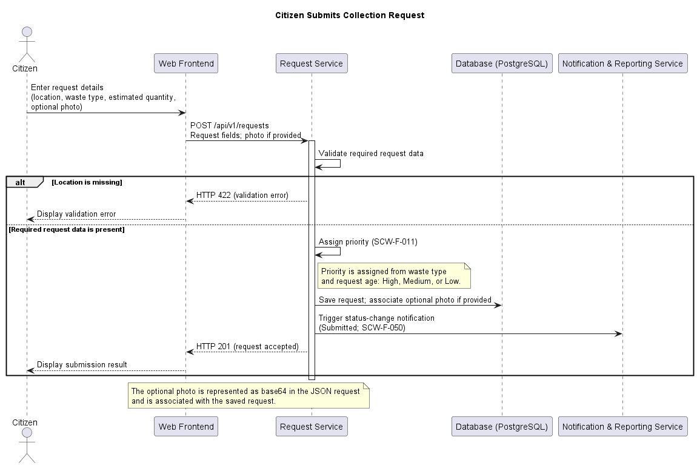

# Software Architecture & Design

| Item | Value |
|---|---|
| Project | Smart City Waste Management System |
| Version | 1.0 |
| Authors | Team 04 – Sonu Akash, Rishit V N S, Rottela Haritej, Purushothama KC |
| Date | 10-10-2026 |
| Status | Draft |

## 4.2 UML Sequence Diagram 1 — Citizen Submits Collection Request

This sequence diagram describes how a Citizen submits a collection request through the Web Frontend. It shows the Request Service validating the required request data, assigning priority, saving the request, and triggering a status-change notification for the Submitted status. The missing-location branch shows the validation failure specified by SCW-F-010.

PlantUML source: [seq-submit-request.puml](../diagrams/seq-submit-request.puml).

### Participants

| Participant | Responsibility in this flow |
|---|---|
| Citizen | Enters the request location, waste type and estimated quantity, and may include an optional photo. |
| Web Frontend | Presents the submission form, sends request data to the Request Service, and displays the validation error or submission result. |
| Request Service | Validates required request data, assigns request priority and manages request creation. |
| Database (PostgreSQL) | Stores the request through the Request Service. If supplied, the optional photo is associated with the saved request as specified by SCW-F-010. |
| Notification & Reporting Service | Is triggered by the Request Service for the Submitted status, consistent with SCW-F-050. |

### Normal Request Flow

1. The Citizen enters a location (map pin or address), waste type and estimated quantity in the Web Frontend; adding a photo is optional.
2. The Web Frontend submits the request to the Request Service using `POST /api/v1/requests`, following the documented REST/JSON API convention.
3. The Request Service validates the required request data. When the required data is present, it assigns priority under SCW-F-011: hazardous, medical or e-waste is High; mixed, general or recyclable waste is Medium; garden or bulky waste is Low. A request that remains Submitted or Approved after 48 hours increases by one priority level, capped at High.
4. The Request Service saves the request in Database (PostgreSQL). When a photo was supplied, it is associated with the stored request. The project documents do not define the photo's representation or transfer mechanism.
5. The Request Service triggers the Notification & Reporting Service for the Submitted status, as shown in the diagram. This depicts the notification trigger only; it does not specify delivery success, timing or retries.
6. The Request Service returns HTTP 201 for the accepted request, and the Web Frontend displays the submission result to the Citizen.

### Missing-Location Validation

If the location is missing, the Request Service rejects the submission with HTTP 422, and the Web Frontend displays a validation error. The failed branch does not proceed to priority assignment, request saving or notification triggering. This behavior is specified by SCW-F-010 and covered by TC-REQ-01.

### Open Specification Item

The project documents specify that a supplied photo is associated with the saved request, but do not specify its representation or transfer mechanism. Those implementation details require project-team confirmation; the sequence diagram intentionally leaves them unspecified.
