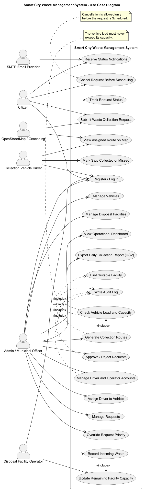

# 7. Use-Case Diagram

## 7.1 Purpose

The use-case diagram describes the interactions between the Smart City Waste Management System and its operational actors. It presents the major functions available to citizens, collection vehicle drivers, administrators, and disposal facility operators.

## 7.2 Actors

| Actor | Responsibilities |
|---|---|
| Citizen | Registers and logs in, submits waste collection requests, tracks request status, cancels eligible requests, and receives status notifications. |
| Collection Vehicle Driver | Views the assigned route and marks collection stops as Collected or Missed. |
| Admin / Municipal Officer | Manages requests, users, vehicles, and disposal facilities; assigns drivers; generates routes; views the dashboard; and exports collection reports. |
| Disposal Facility Operator | Records incoming waste and updates facility capacity. |
| OpenStreetMap / Geocoding Service | Supports map display and location-related functions. |
| SMTP Email Provider | Delivers email notifications for request status changes. |

## 7.3 Main Use Cases

The diagram covers the following major interactions:

- **Authentication and access:** User registration and login, with role-based access to system functions.
- **Request management:** Citizens submit, track, and cancel eligible collection requests. Administrators review requests, approve or reject them, and override priority when required.
- **Vehicle management:** Administrators add or edit vehicles, manage vehicle status, and assign drivers.
- **Facility management:** Administrators manage disposal facilities, while facility operators record incoming waste and update remaining capacity.
- **Route management:** Administrators generate collection routes. The system considers request priority, distance, vehicle capacity, and suitable disposal facilities.
- **Collection operations:** Drivers view their assigned routes and record whether each stop was collected or missed.
- **Notifications and reporting:** Citizens receive status notifications, and administrators view operational information and export daily collection reports.
- **Audit logging:** Relevant administrative actions are recorded for accountability.

## 7.4 Diagram

The PlantUML source and generated diagram image are maintained at:

- Source: `docs/diagrams/use-case.puml`
- Image: `docs/diagrams/use-case.png`

## 7.5 Requirement Traceability

The use cases correspond to the functional requirements in `docs/requirements-registry.md`, including:

- `SCW-F-001` to `SCW-F-003`: Authentication, role-based access, and account management.
- `SCW-F-010` to `SCW-F-014`: Waste collection requests and request administration.
- `SCW-F-020` to `SCW-F-023`: Vehicle management and load tracking.
- `SCW-F-030` to `SCW-F-032`: Disposal facility management and capacity updates.
- `SCW-F-040` to `SCW-F-044`: Route generation and collection operations.
- `SCW-F-050` to `SCW-F-052`: Notifications, dashboard, and reporting.

Security requirements are documented separately in the security section of the SRS.

